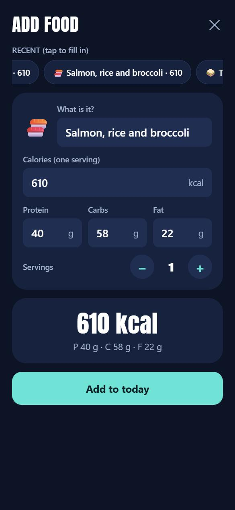

# 🍴 Forkcast

**Snap your food, see the calories, hit your goal.** Take a photo of a meal and Forkcast's AI estimates the calories, protein, carbs and fat in a few seconds. Tweak anything that looks off, tap **Add to today**, and watch your daily ring fill up.

**[▶ Try the live app](https://jack1071-forkcast.expo.app)** (works best at phone size), or scan this with your phone's camera:


**📱 Put it on your phone:** open the link on your phone, then:
- **iPhone (Safari):** tap **Share → Add to Home Screen**
- **Android (Chrome):** tap **⋮ → Add to Home screen**

It gets its own icon and opens full screen like a normal app. You can log food by hand as a guest. Photo estimates need a free account and an invite code (they're paid for per photo, so they're invite-only for now).

<p>
  
  
  
  
</p>

## Features

- **📸 Snap → estimate → add.** Take a photo (or pick one) and Claude AI names the food, picks an emoji, and estimates calories and macros. Everything is editable, with a servings stepper, before it goes in your log.
- **A daily target made for you.** A quick setup asks your age, sex, height, weight, activity and goal, then works out your calories with the Mifflin-St Jeor equation and splits them into protein, carbs and fat.
- **Today at a glance.** A calorie ring that fills as you eat (and turns orange if you go over), macro bars, and a nudge like *"You have 880 kcal left today."*
- **Add without a photo.** Type it in, or tap one of your recent foods to fill everything in at once.
- **History calendar.** Every day is colored: aqua for on target, orange for over. Tap a day to see what you ate.
- **Progress.** Log your weight and see your trend line, plus a 7-day calorie chart against your goal.
- **Streaks.** 🔥 Days in a row with food logged, so there's a reason to come back tomorrow.
- **Accounts and cloud backup (optional).** Sign up with email and your log is backed up and synced across devices. There's also forgot password and delete account.
- **Private by design.** Row Level Security means each account can only ever read or change its own data, and food photos are never stored.

## How it's designed

I planned the app with a 5-step framework before building it:

| Step | In this app |
|---|---|
| **Core function** | Snap your food and see its calories and macros |
| **Core loop** (action → reward in under 30 seconds) | Snap → AI estimate → tweak → Add → the ring fills up |
| **Accessory features** (only what supports the loop) | Goal setup, manual add, recent foods, history calendar, weight log and charts |
| **Surface area** (5–7 screens max) | 5 core screens: Setup, Today, Snap & Review, History, Progress (plus sign-in and privacy) |
| **Retention hook** | Logging streak and the "kcal left today" nudge |

## How the AI part works (and stays safe)

```
 Phone / browser                     Supabase                          Anthropic
┌───────────────────┐   photo   ┌──────────────────────────┐  photo  ┌────────────┐
│ Forkcast app      │ ────────▶ │ analyze-food function    │ ──────▶ │ Claude API │
│ (shrinks photo to │           │ 1. Is this a signed-in   │         └────────────┘
│  1024 px first)   │ ◀──────── │    account?              │ ◀──────  estimate as
└───────────────────┘ estimate  │ 2. Invite code entered?  │          structured JSON
                                │ 3. Under today's limits? │
                                │ (API key is a secret     │
                                │  that lives only here)   │
                                └──────────────────────────┘
```

- **The Claude API key never ships in the app.** It's stored as a server secret on a Supabase Edge Function, so nobody can pull it out of the website or phone app.
- **Only signed-in accounts that entered the invite code** can use the AI.
- **Daily limits** (per person and for the whole app) are enforced in Postgres with a locked counter, so even rapid-fire requests can't slip past. If the AI call fails, the photo doesn't count against your limit.
- **Structured output:** Claude replies in a fixed JSON shape (name, emoji, calories, protein, carbs, fat, confidence), so the app never has to guess at free text. Not-food photos get a friendly "try another photo".

## Built with

- [React Native](https://reactnative.dev) + [Expo](https://expo.dev) (SDK 58) and Expo Router, in TypeScript
- [Claude](https://www.anthropic.com/claude) (Anthropic API) for food photo analysis
- [Supabase](https://supabase.com): email sign-in, a Postgres database with Row Level Security, and an Edge Function (Deno) for the AI calls
- `expo-image-picker` + `expo-image-manipulator` for taking and shrinking photos
- `react-native-svg` for the calorie ring and charts
- AsyncStorage for saving data on the device (local-first: instant on the device, synced in the background)
- Published with EAS Update (phone) and EAS Hosting (web)

Built with [Claude Code](https://claude.com/claude-code) as an AI pair programmer while following a course on building mobile apps.

## Run it yourself

1. Install dependencies:
   ```bash
   npm install
   ```
2. Start the app:
   ```bash
   npx expo start
   ```
   Scan the QR code with the **Expo Go** app, or press `w` for the browser. Without a Supabase project the app runs in guest mode, and photos get sample estimates so you can try the whole flow.
3. *(Optional: accounts and real AI)*
   1. Create a [Supabase](https://supabase.com) project and link it: `npx supabase link --project-ref <your-ref>`.
   2. Set up the database: `npx supabase db push`.
   3. Push the auth settings: `npx supabase config push`.
   4. Deploy the function: `npx supabase functions deploy analyze-food --use-api`.
   5. Add the secrets `ANTHROPIC_API_KEY` (from [console.anthropic.com](https://console.anthropic.com)) and `FORKCAST_INVITE_CODE` (any code you like).
   6. Copy `.env.example` to `.env` and fill in your project URL and publishable key.

If your phone can't connect over Wi-Fi, use `npx expo start --tunnel` instead.

## Privacy

The privacy policy is at [/privacy](https://jack1071-forkcast.expo.app/privacy). People can delete their account and all their data at any time from **Progress → Delete my account**. Food photos are sent to Anthropic only to make the estimate and are not stored by Forkcast.

*Calorie targets and estimates are general guides, not medical advice.*

## Project structure

```
src/
  app/
    _layout.tsx           Loads the headline font
    index.tsx             The brain: app state, tabs, sign-in and cloud sync
    privacy.tsx           Privacy policy page
  components/
    bits.tsx              Calorie ring, macro bars, buttons, inputs
    screens/              Setup, Today, Review (snap & edit), History, Progress, Sign in
  lib/
    food.ts               Data model, Mifflin-St Jeor maths, streaks, saving on the device
    analyze.ts            Shrinks the photo and asks the server for an estimate
    supabase.ts           Supabase connection
    cloud.ts              Upload / download a signed-in user's data
    use-account.ts        Tracks who is signed in
    ui.ts                 Colors, fonts and haptics
supabase/
  functions/analyze-food/ Edge Function: checks the user, invite code and limits, calls Claude
  migrations/             Tables, Row Level Security rules and limit counters
scripts/
  add-web-tags.js         Adds "Add to Home Screen" tags to the web build
  make-icons.py           Draws the app icon in every size
```

## License

MIT
